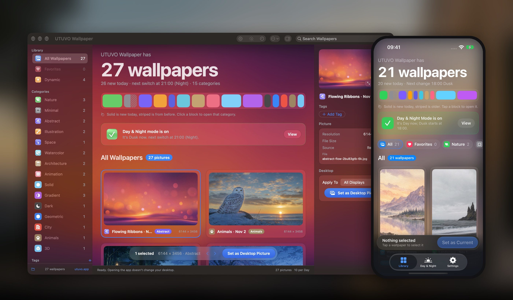
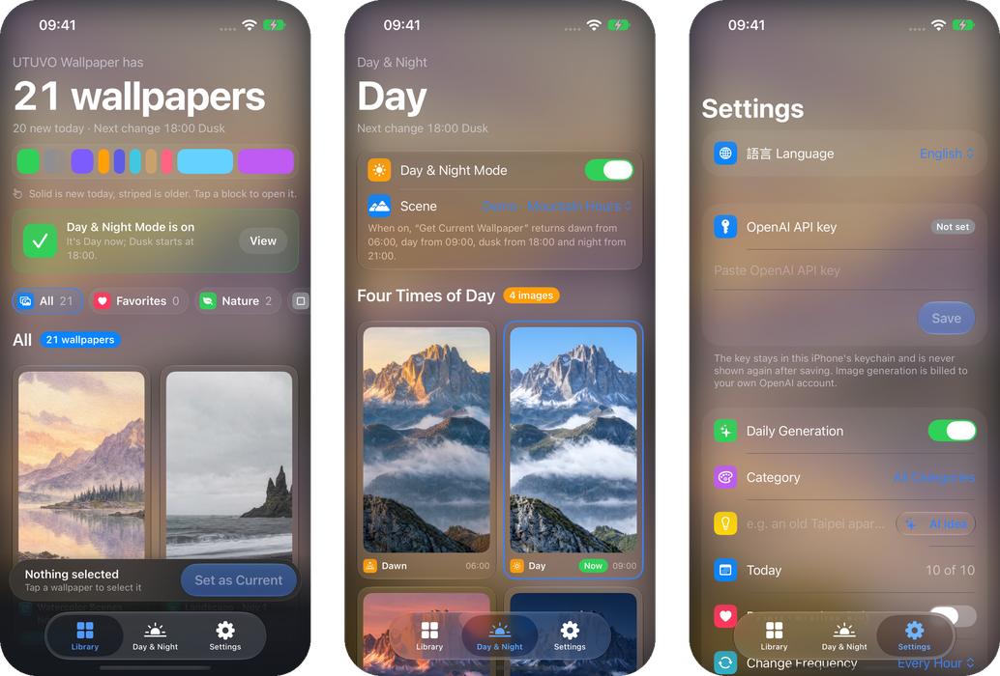

# UTUVO Wallpaper

A small native macOS wallpaper app with a Liquid Glass interface. It generates ten fresh wallpapers every day with your own OpenAI API key — new subjects, colors, light and composition each day, in the categories you pick or from your own prompt — sorts them into fifteen categories, rotates them across all your displays, and turns one scene into a day-to-night wallpaper that follows the time of day. Solid colors and gradients are drawn right on your Mac, no API key needed.

[Download for macOS](https://github.com/mickyyang-1407/utuvo-wallpaper/releases/latest) · [繁體中文](README.zh-Hant.md)

macOS 14 or later · Apple silicon and Intel · English and 繁體中文 · MIT



## What it does

- **Ten fresh wallpapers a day.** Each style rotates through its own subjects and palettes by day, with changing light and composition, so a style never repeats a subject until it has used them all. One batch per day at most.
- **Fifteen categories.** Nature, minimal, abstract, illustration, space, watercolor, architecture, animation, dark (OLED black), geometric, city, animals and 3D are generated with your key; **solid colors and gradients are drawn locally — instant, free and no key required.**
- **Your categories, your prompt.** Pick categories for the daily batch and for one-off generations, or write your own prompt and get it painted in each style. Stuck? **AI Idea** fills the prompt with a subject that fits the categories you picked.
- **Large preview.** Double-click a thumbnail (or click the picture in the inspector) for a big preview; ← / → to browse, Esc to close, set it as your wallpaper right there.
- **Categories in the sidebar.** Every category is listed; empty ones are dimmed and offer a one-click “Generate This Category”.
- **Tags and resolution.** Make your own colored tags, and browse by 6K, 5K or 4K.
- **Select many, clean up fast.** ⌘-click, Shift-click and ⌘A to select, ⌥-click to drop one from the selection; move them to the Trash together, originals included. Pictures in use on a display are never moved.
- **Rotation.** Rotate through your 6K pictures (or only your favorites) every 5, 15 or 30 minutes, hourly or daily, on one display or all of them — or a different picture on each display. Pause anytime, and go back to the previous wallpaper.
- **Day and night.** Describe a scene. The app generates a daytime picture, then edits that same picture into dawn, dusk and night, so the camera and layout stay the same and only the light changes. It switches at fixed times (06:00, 09:00, 18:00, 21:00), at your local sunrise and sunset, or with macOS Light/Dark appearance; a 24-hour timeline shows where you are, and a scene library keeps every scene you made. Turn on **AI Auto** (daily or weekly) and it picks a seasonal scene and builds the four times of day by itself.
- **Menu bar, hotkeys and Shortcuts.** A menu bar icon for next, previous, favorite and pause; global hotkeys ⌃⌥⌘→ / ⌃⌥⌘← / ⌃⌥⌘F / ⌃⌥⌘P; and `utuvo-wallpaper://next` (also `previous`, `favorite`, `pause`, `resume`) for the Shortcuts app’s “Open URL” action.
- **Liquid Glass.** On macOS 26 cards, menus and panels are real Liquid Glass over a blurred, saturated copy of the picture you are looking at.
- **Language.** English or Traditional Chinese, or follow the system, in Settings.
- **Runs in the background.** An optional per-user LaunchAgent keeps the daily batch and the time-of-day switching going with the window closed.

New pictures are generated at 3840 × 2160 and saved alongside a 6144 × 3456 version resampled with Core Graphics. That is resampling, not native 6K and not AI upscaling. The originals are kept.

## Install

1. [Download the DMG](https://github.com/mickyyang-1407/utuvo-wallpaper/releases/latest) and drag **UTUVO Wallpaper** into **Applications**.
2. Open it from Applications. It is signed with a Developer ID and notarized by Apple.
3. Open **Settings** (⌘,) and paste your OpenAI API key. Without a key you can still browse the demo pictures.
4. To keep generating and switching with the window closed, turn on the background service in Settings. It only works when the app runs from the Applications folder.

## Build from source

You need macOS 14 or later and Xcode or the Command Line Tools. There are no third-party packages.

```sh
git clone https://github.com/mickyyang-1407/utuvo-wallpaper.git
cd utuvo-wallpaper
bash build.sh
open "Delivery/UTUVO Wallpaper.app"
```

The build uses `swiftc` directly and signs the app ad hoc. Signed releases are made with `scripts/release.sh`, which builds a universal app, signs it with your Developer ID and notarizes the DMG and ZIP.

## iPhone



The `ios/` folder holds the iPhone version (iOS 17 or later). It has the same ten styles, categories, favorites and day-and-night scenes, generated in portrait and cropped to your screen.

iOS does not let apps change the wallpaper themselves, so the app works with Shortcuts:

1. In the Shortcuts app, open **Automation**, tap **+**, choose **Time of Day**, pick a time and **Run Immediately**.
2. Add the **Get Current Wallpaper** action from UTUVO Wallpaper, then the built-in **Set Wallpaper** action, and turn off **Show Preview**.
3. For day and night, make four automations at 06:00, 09:00, 18:00 and 21:00.

The app has the same guide under **Settings**. Daily pictures are generated when you open the app, and iOS may also run the batch in the background overnight; it does not promise an exact time.

To build it you need Xcode and [XcodeGen](https://github.com/yonaskolb/XcodeGen):

```sh
cd ios && xcodegen generate
open UTUVOWallpaper.xcodeproj
```

## Your API key

Generating pictures uses the OpenAI Images API (`gpt-image-2`) and is billed to **your** OpenAI account. Each picture is one request; a day-and-night scene is one generation plus three edits. Without a key you can still browse the bundled demo pictures.

The key is read in this order:

1. The Mac Keychain. Use **Settings** in the app to save, replace or remove it.
2. The `OPENAI_API_KEY` environment variable.
3. A local file at `~/.config/utuvo-wallpaper/openai.env` containing `OPENAI_API_KEY=...`.

The key stays in memory only. It is never written to logs, status files, error messages or the pictures' metadata. If the Keychain is locked or access is denied, the app stops instead of falling back to another source.

If a connection drops, the daily batch resumes the missing themes later, with at most three requests per theme. A request that the provider completed but whose reply never arrived can still be billed.

## Where your data lives

Pictures, originals, favorites and progress files are stored in `~/Library/Application Support/UTUVO Wallpaper`. Set `UTUVO_WALLPAPER_DATA_DIR` to use another folder. A daily batch takes about 130 MB (originals plus 6K versions), and nothing is deleted automatically.

## Command line

```sh
APP="Delivery/UTUVO Wallpaper.app/Contents/MacOS/WallpaperLab"
"$APP" --self-test            # isolated checks: no network, no desktop changes
"$APP" --background-status    # read-only background service status
"$APP" --inspect-displays     # read-only: current wallpaper on each display
```

The self-test uses a temporary folder, a separate preferences suite, a fake image provider, a fake desktop and a throwaway Keychain item, and cleans up after itself.

`Localization/check.py` checks that every looked-up string has an English translation.

## Known limits

- Tested on Apple silicon; the Intel build was checked under Rosetta.
- The day-and-night switching is done by the app's background service. The exported HEIC uses the fixed 06/09/18/21 times and is a bonus; switching through macOS's own dynamic wallpaper support has not been verified.
- Day-and-night generation runs in the app window, so keep it open until the four pictures are done.

## License

Code is [MIT](LICENSE). The bundled demo pictures and app icon are original AI-generated artwork made for this project.

Made by [Micky Yang](https://github.com/mickyyang-1407).

---

[utuvo.app](https://utuvo.app) · [Website](https://mickyyang-1407.github.io/utuvo-wallpaper/)
