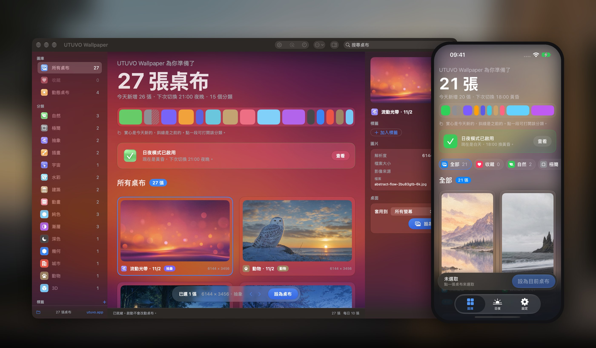
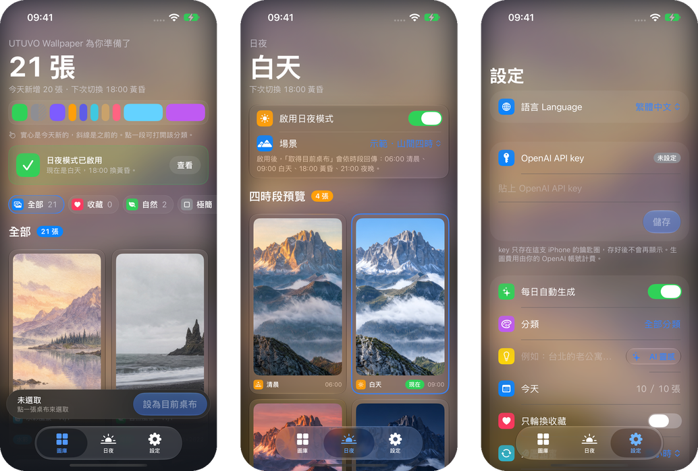
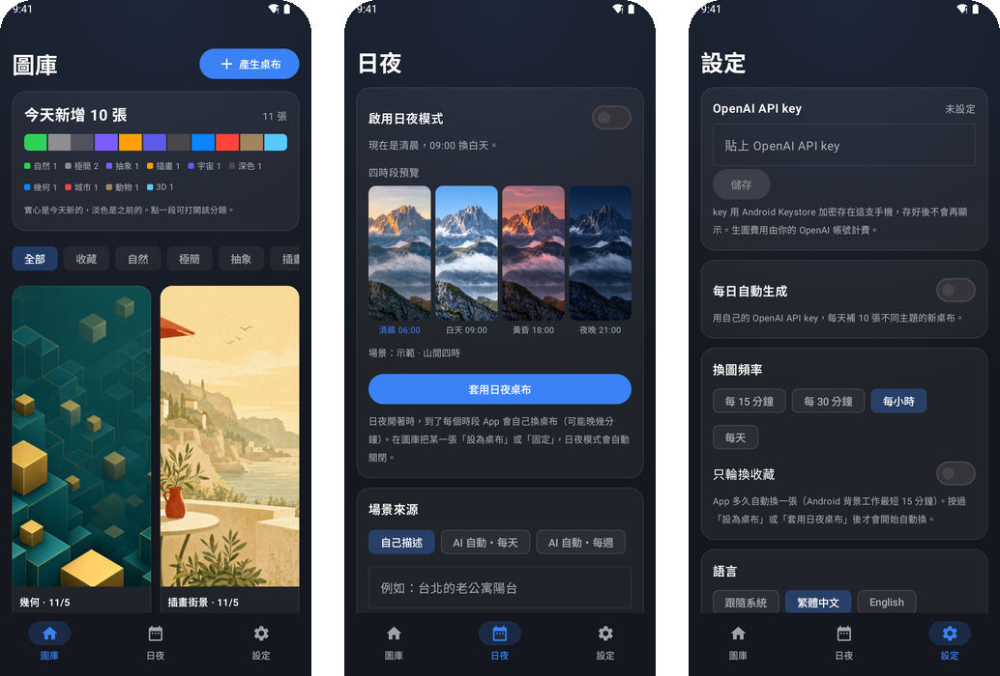

# UTUVO Wallpaper

小巧的 macOS 原生桌布 App，整個介面是 Liquid Glass。用你自己的 OpenAI API key，每天生成 10 張新桌布：每天換主題、配色、光線與構圖，可以選分類，也可以寫自己的 Prompt；15 個分類自動整理，在所有螢幕上輪換，還能把一個場景做成跟著時間從清晨變到夜晚的日夜桌布。純色與漸層直接在你的 Mac 上畫，不需要 API key。

[下載 macOS 版](https://github.com/mickyyang-1407/utuvo-wallpaper/releases/latest) · [下載Android版](https://github.com/mickyyang-1407/utuvo-wallpaper/releases/tag/android-v0.1.0) · [English](README.md)

macOS 14 以上 · Apple Silicon 與 Intel · English／繁體中文 · MIT



## 功能

- **每天 10 張新桌布**：每個風格按天輪換主題與配色，光線、構圖也跟著換；同一風格要把主題全部用過一輪才會重複。每天最多一批。
- **15 個分類**：自然、極簡、抽象、插畫、宇宙、水彩、建築、動畫、深色（OLED 純黑）、幾何、城市、動物、3D 用你的 key 生成；**純色與漸層在本機直接畫，瞬間完成、不花額度、不需要 key。**
- **自己選分類、自己寫 Prompt**：每日批次與手動產生都能選分類，也能寫自己的 Prompt，用選的分類輪流表現。想不到主題就按 **AI 靈感**，依你選的分類填一個點子。
- **大圖預覽**：縮圖按兩下（或點檢視器裡的圖）看大圖，←／→ 換張、Esc 關閉，可以直接設為桌布。
- **側欄分類**：所有分類都列出來，還沒有圖的會變淡，點進去一鍵「產生這個分類」。
- **標籤與解析度**：自訂彩色標籤，也能依 6K、5K、4K 瀏覽。
- **多選、一次整理**：⌘＋點、Shift＋點、⌘A 選取，⌥＋點把一張移出選取；可一起移到垃圾桶（連同原圖），正在當桌布的圖不會被移走。
- **輪換**：每 5／15／30 分鐘、每小時或每天，在單一或全部螢幕輪換 6K 成品，也可以只輪換收藏，或讓每顆螢幕各放不同張。可隨時暫停、回到上一張。
- **日夜桌布**：輸入場景描述，先生成白天，再用同一張圖編修出清晨、黃昏、夜晚，構圖不變、只換光線。可選固定時間（06:00、09:00、18:00、21:00）、依所在地日出日落，或跟著系統淺色／深色切換；24 小時時間軸顯示現在位置，場景庫保留你做過的每個場景。開啟 **AI 自動**（每天或每週），會依季節自己挑場景、做好四個時段。
- **選單列、快捷鍵與捷徑**：選單列圖示可下一張、上一張、收藏、暫停；全域快捷鍵 ⌃⌥⌘→／⌃⌥⌘←／⌃⌥⌘F／⌃⌥⌘P；捷徑 App 用「打開 URL」填 `utuvo-wallpaper://next`（也可 `previous`、`favorite`、`pause`、`resume`）。
- **Liquid Glass**：macOS 26 上卡片、選單、側欄都是原生 Liquid Glass，背後透出你正在看的那張桌布（模糊、加飽和）。
- **語言**：設定裡可選繁體中文、English 或跟隨系統。
- **背景執行**：可選擇啟用使用者層級的 LaunchAgent，關掉視窗後仍會照常每日生成與切換時段。

新圖原生 3840 × 2160，另存一張以 Core Graphics 重採樣的 6144 × 3456。這是重採樣，不是原生 6K，也不是 AI 超解析；原圖會保留。

## 安裝

1. [下載 DMG](https://github.com/mickyyang-1407/utuvo-wallpaper/releases/latest)，把 **UTUVO Wallpaper** 拖進「應用程式」。
2. 從「應用程式」打開。已用 Developer ID 簽章並通過 Apple 公證。
3. 打開**設定**（⌘,），貼上你的 OpenAI API key。沒有 key 也能瀏覽示範圖。
4. 想關掉視窗後仍每天生成與切換，到設定開啟背景服務；App 必須在「應用程式」資料夾裡才能開。

## 從原始碼編譯

需要 macOS 14 以上，以及 Xcode 或 Command Line Tools。沒有第三方套件。

```sh
git clone https://github.com/mickyyang-1407/utuvo-wallpaper.git
cd utuvo-wallpaper
bash build.sh
open "Delivery/UTUVO Wallpaper.app"
```

直接用 `swiftc` 編譯並做 ad-hoc 簽章，正式版用 `scripts/release.sh` 產生：編 universal、用你的 Developer ID 簽章，並把 DMG 與 ZIP 送 Apple 公證。

## iPhone 版



`ios/` 資料夾是 iPhone 版（iOS 17 以上）：同樣的 10 種風格、分類、收藏與日夜桌布，以直式生成並裁成你的螢幕尺寸。

iOS 不允許 App 自己換桌布，所以搭配「捷徑」：

1. 打開「捷徑」App 的**自動化**，點 **+**，選**特定時間**，設定時間並選**立即執行**。
2. 加入 UTUVO Wallpaper 的**取得目前桌布**，再加入系統內建的**設定背景圖片**，關掉**顯示預覽**。
3. 日夜桌布請在 06:00、09:00、18:00、21:00 各建一個自動化。

App 的**設定**裡有同樣的指南。每日的圖會在打開 App 時生成，iOS 也可能在夜間背景補做，但不保證準時。

編譯需要 Xcode 與 [XcodeGen](https://github.com/yonaskolb/XcodeGen)：

```sh
cd ios && xcodegen generate
open UTUVOWallpaper.xcodeproj
```

## Android 版



[下載APK](https://github.com/mickyyang-1407/utuvo-wallpaper/releases/tag/android-v0.1.0)，在手機上打開安裝（Android問要不要允許從瀏覽器或檔案App安裝時，按允許）。沒有上Google Play。

`android/` 資料夾是 Android 版（Android 10 以上）：同樣的風格、分類、收藏、AI 靈感與日夜桌布，大圖可以左右滑換張。

Android 允許 App 直接換桌布，不用另外設定：按**設為桌布**，主畫面和鎖定畫面就會換。之後輪換與日夜會在背景自動切換（最短每 15 分鐘；日夜到點可能晚幾分鐘，因為 App 不要求精確鬧鐘權限）。重開機後排程仍在；如果在 Android 設定裡「強制停止」App，系統會清掉排程，直到你再打開 App。

API key 用 Android Keystore 加密保存，存好後不會再顯示。

編譯需要 JDK 21 與 Android SDK：

```sh
cd android && ./gradlew assembleRelease
```

## API key

生圖使用 OpenAI Images API（`gpt-image-2`），費用由**你自己的** OpenAI 帳號支付。每張圖一次請求；一組日夜桌布是一次生成加三次編修。沒有 key 也能瀏覽內附的示範圖。

讀取順序：

1. Mac 鑰匙圈：在 App 的**設定**儲存、替換或移除。
2. 環境變數 `OPENAI_API_KEY`。
3. 本機檔案 `~/.config/utuvo-wallpaper/openai.env`，內容為 `OPENAI_API_KEY=...`。

key 只存在記憶體裡，不會寫進日誌、狀態檔、錯誤訊息或圖片資料。鑰匙圈鎖住或被拒絕時會直接停止，不會偷偷改用別的來源。

連線中斷時，每日批次之後會只補未完成的主題，每個主題最多 3 次請求。若供應商已完成生成、但回應沒收到，仍可能計費。

## 資料位置

圖片、原圖、收藏與進度檔存在 `~/Library/Application Support/UTUVO Wallpaper`；可用 `UTUVO_WALLPAPER_DATA_DIR` 指定其他資料夾。每天一批大約 130 MB（原圖加 6K 成品），不會自動刪除。

## 命令列

```sh
APP="Delivery/UTUVO Wallpaper.app/Contents/MacOS/WallpaperLab"
"$APP" --self-test            # 隔離自測：不連網、不改桌布
"$APP" --background-status    # 唯讀：背景服務狀態
"$APP" --inspect-displays     # 唯讀：各螢幕目前的桌布
```

自測使用暫存資料夾、獨立偏好設定、假的生圖服務、假的桌面與一次性的鑰匙圈項目，結束後自行清除。

`Localization/check.py` 會檢查每一條介面字串都有英文翻譯。

## 已知限制

- 在 Apple Silicon 測試；Intel 版以 Rosetta 驗過。
- 日夜切換由 App 的背景服務負責。可匯出的 HEIC 固定用 06／09／18／21 時段，是附加功能，macOS 原生動態桌布的全天切換未經驗證。
- 日夜桌布的生成在 App 視窗中進行，四張完成前請保持開啟。

## 授權

程式碼採 [MIT](LICENSE)。內附示範圖與 App 圖示為本專案原創的 AI 生成作品。

作者：[Micky Yang](https://github.com/mickyyang-1407)

---

[utuvo.app](https://utuvo.app) · [網站](https://mickyyang-1407.github.io/utuvo-wallpaper/)
