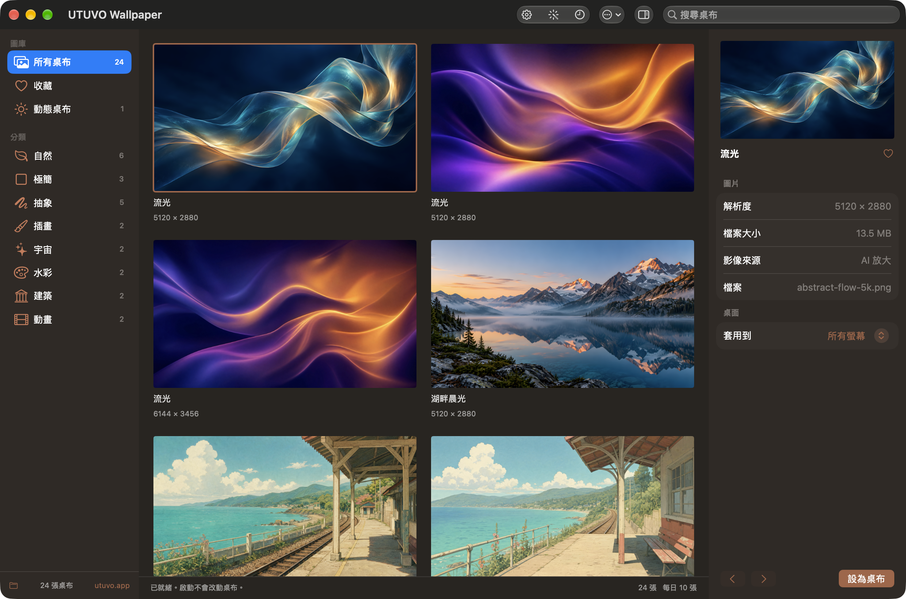

# UTUVO Wallpaper

小巧的 macOS 原生桌布 App。用你自己的 OpenAI API key，每天生成 10 張不同風格的桌布，自動分類，在所有螢幕上輪換；也能把一個場景做成跟著時間從清晨變到夜晚的日夜桌布。

[English](README.md)

macOS 14 以上 · 已在 Apple Silicon 測試 · English／繁體中文 · MIT



## 功能

- **每天 10 種風格**：自然、極簡、抽象、插畫、宇宙、水彩、建築、動畫等原創主題。每天最多一批。
- **分類**：側欄依主題自動分類，另有所有桌布、收藏與動態桌布。
- **輪換**：在單一或全部螢幕輪換 6K 成品，也可以只輪換收藏。
- **日夜桌布**：輸入場景描述，先生成白天，再用同一張圖編修出清晨、黃昏、夜晚，構圖不變、只換光線。依本機時間 06:00、09:00、18:00、21:00 切換。
- **背景執行**：可選擇啟用使用者層級的 LaunchAgent，關掉視窗後仍會照常每日生成與切換時段。

新圖原生 3840 × 2160，另存一張以 Core Graphics 重採樣的 6144 × 3456。這是重採樣，不是原生 6K，也不是 AI 超解析；原圖會保留。

## 編譯

需要 macOS 14 以上，以及 Xcode 或 Command Line Tools。沒有第三方套件。

```sh
git clone https://github.com/mickyyang-1407/utuvo-wallpaper.git
cd utuvo-wallpaper
bash build.sh
open "Delivery/UTUVO Wallpaper.app"
```

直接用 `swiftc` 編譯並做 ad-hoc 簽章，不是 Developer ID 簽署，也沒有公證。要用背景服務，請先把 App 放到 `~/Applications`，再到設定開啟。

## API key

生圖使用 OpenAI Images API（`gpt-image-2`），費用由**你自己的** OpenAI 帳號支付。每張圖一次請求；一組日夜桌布是一次生成加三次編修。沒有 key 也能瀏覽內附的示範圖。

讀取順序：

1. Mac 鑰匙圈：在 App 的**設定**儲存、替換或移除。
2. 環境變數 `OPENAI_API_KEY`。
3. 本機檔案 `~/.config/utuvo-wallpaper/openai.env`，內容為 `OPENAI_API_KEY=...`。

key 只存在記憶體裡，不會寫進日誌、狀態檔、錯誤訊息或圖片資料。鑰匙圈鎖住或被拒絕時會直接停止，不會偷偷改用別的來源。

連線中斷時，每日批次之後會只補未完成的主題，每個主題最多 3 次請求。若供應商已完成生成、但回應沒收到，仍可能計費。

## 資料位置

圖片、原圖、收藏與進度檔存在 `~/Library/Application Support/UTUVO Wallpaper`；可用 `UTUVO_WALLPAPER_DATA_DIR` 指定其他資料夾。每天一批大約 130 MB（原圖加 6K 成品），不會自動刪除。

## 命令列

```sh
APP="Delivery/UTUVO Wallpaper.app/Contents/MacOS/WallpaperLab"
"$APP" --self-test            # 隔離自測：不連網、不改桌布
"$APP" --background-status    # 唯讀：背景服務狀態
"$APP" --inspect-displays     # 唯讀：各螢幕目前的桌布
```

自測使用暫存資料夾、獨立偏好設定、假的生圖服務、假的桌面與一次性的鑰匙圈項目，結束後自行清除。

`Localization/check.py` 會檢查每一條介面字串都有英文翻譯。

## 已知限制

- 只在 Apple Silicon 測試過。
- 日夜切換由 App 的背景服務負責。可匯出的 HEIC 是附加功能，macOS 原生動態桌布的全天切換未經驗證。
- 日夜桌布的生成在 App 視窗中進行，四張完成前請保持開啟。

## 授權

程式碼採 [MIT](LICENSE)。內附示範圖與 App 圖示為本專案原創的 AI 生成作品。

作者：[Micky Yang](https://github.com/mickyyang-1407)

---

[utuvo.app](https://utuvo.app)
